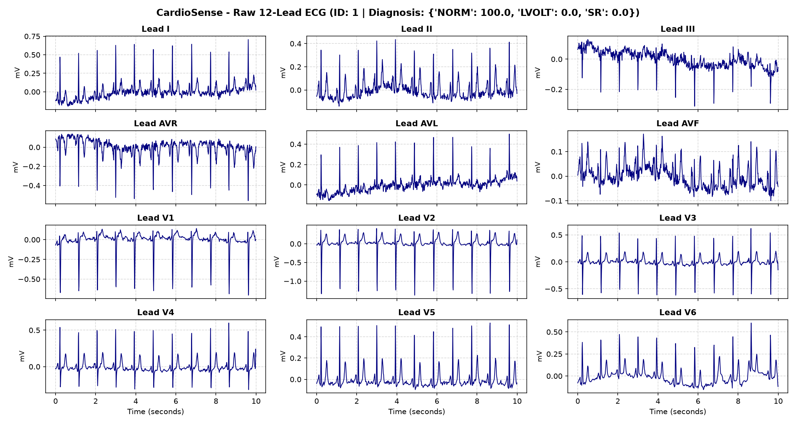
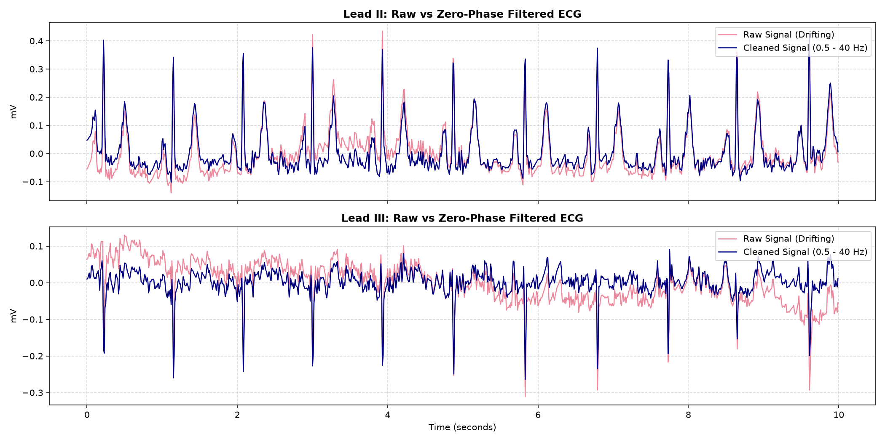
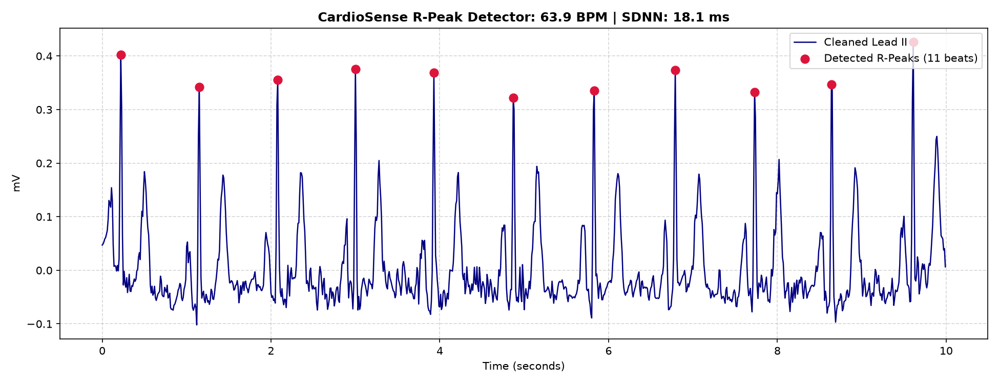
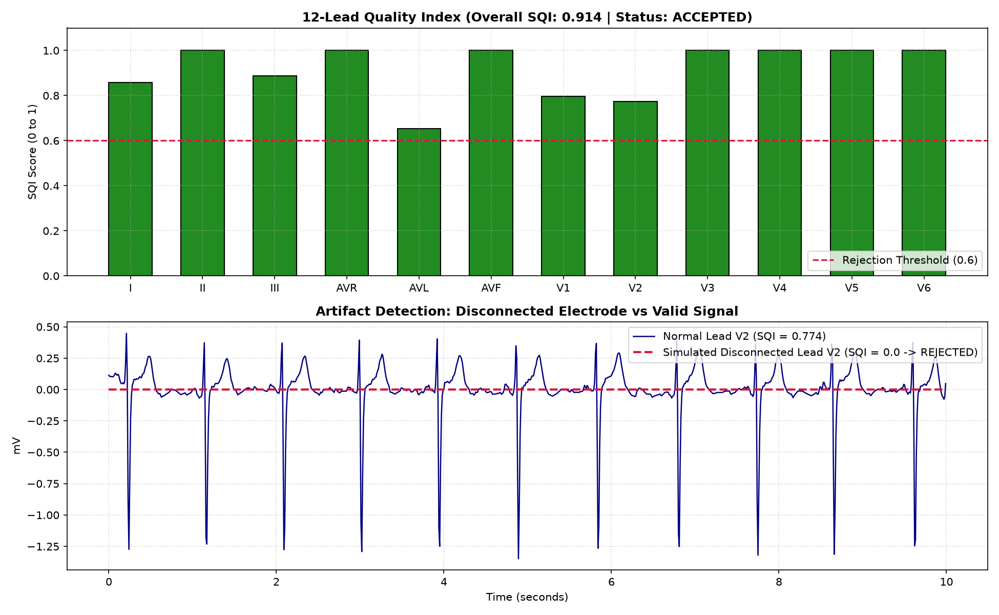
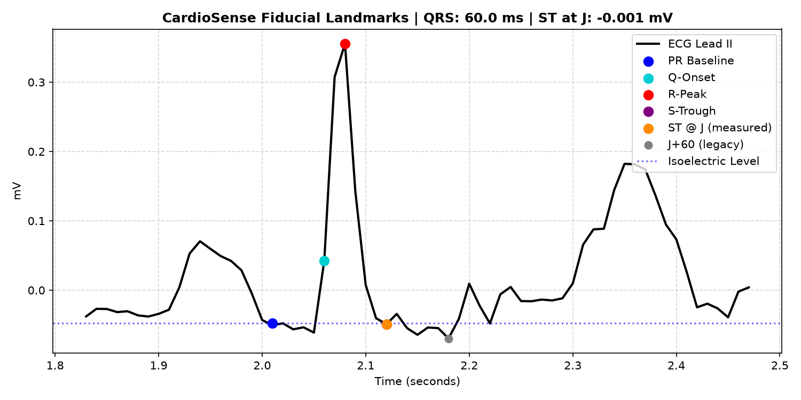
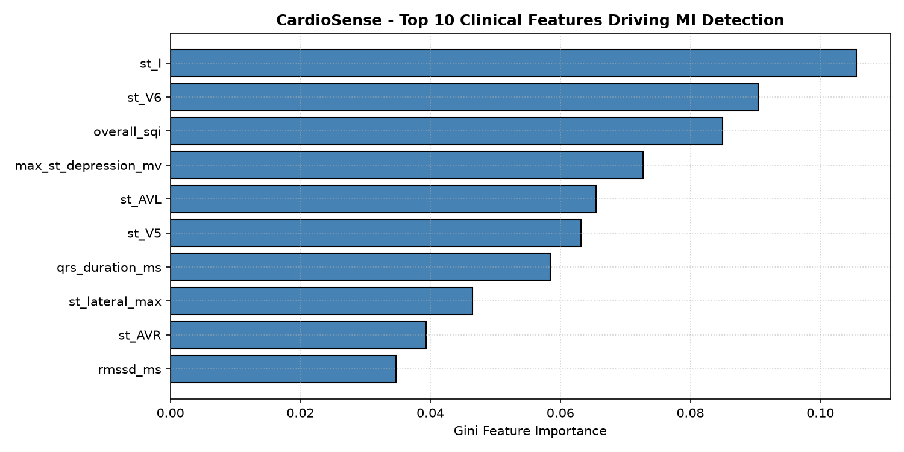
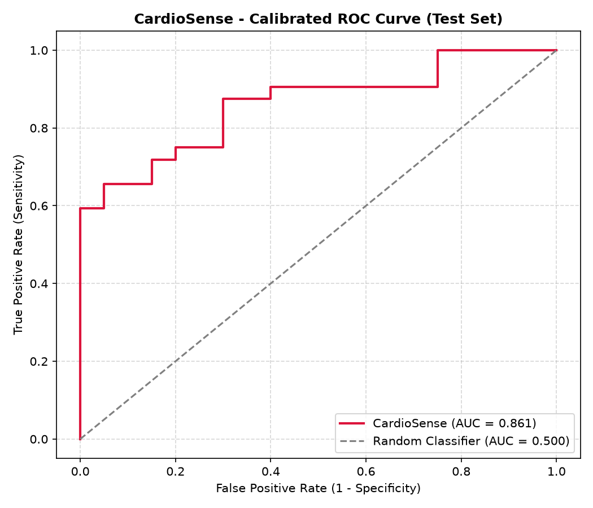
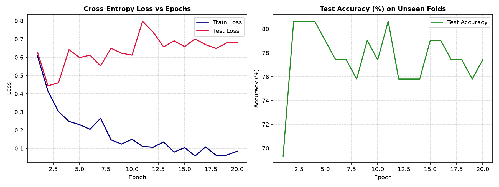
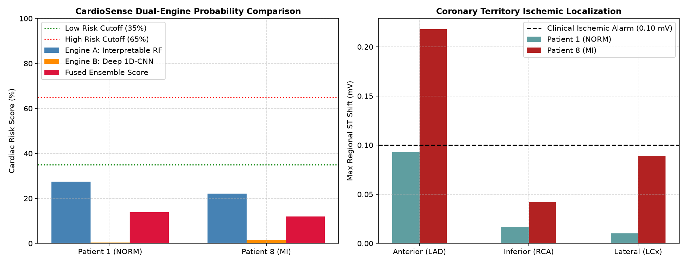

# CardioSense — Clinical Engineering & Verification Log

**Project**: CardioSense — Clinical Decision-Support System (CDSS) for Myocardial Infarction & Ischemia  
**Input Modalities**: Standard 12-Lead ECG (PTB-XL, 100 Hz) & Single-Lead ESP32 Hardware Prototype  
**Architecture**: Dual-Engine (Interpretable Clinical Biomarkers + 1D Waveform CNN) with SQI Quality Gate & Guardrailed Triage  
**Development Standard**: Follows clinical verification and traceability guidelines (IEC 62304 / ISO 13485 concepts)  

---

## Executive Summary

CardioSense is designed to assist emergency clinicians by detecting early electrophysiological signs of acute myocardial infarction (AMI) and myocardial ischemia, routing patients to appropriate tiers of care (*Routine Follow-up*, *Clinician Review*, or *Urgent Emergency Escalation*).

To eliminate "black-box" risk in high-stakes clinical settings, CardioSense enforces:
1. **Signal Quality Indexing (SQI)** to reject unattached or noisy electrodes before inference.
2. **Deterministic Fiducial Landmarking** to measure classical cardiological markers (ST deviation, J-point elevation, QRS duration, HRV).
3. **Calibrated Multi-Model Decision Support** combining interpretable clinical features with raw deep learning embeddings.
4. **Safety-Guardrailed Summarization** strictly grounded in measured data without autonomous speculative diagnoses.

---

## 1. Raw ECG Ingestion & Clinical Baseline Inspection

### Clinical Rationale
Clinical ECG acquisition is prone to real-world physical noise. Patient respiration induces thoracic impedance changes that manifest as low-frequency **baseline wander** (0.1–0.5 Hz). Simultaneously, patient muscle tremors and electromagnetic interference produce high-frequency jitter. Inspecting the raw 12-lead signal establishes the operational baseline.

### Implementation
- **Source**: PhysioNet PTB-XL Dataset v1.0.3 (Record ID: 1).
- **Module**: `src/data/download_ptbxl.py` & `tests/test_inspect_ecg.py`.
- **Dimensions**: 1000 samples × 12 leads (10.0 seconds at $f_s = 100\text{ Hz}$).
- **Cardiologist Diagnosis**: `{'NORM': 100.0, 'LVOLT': 0.0, 'SR': 0.0}` (Normal Sinus Rhythm).

### Observations
The raw recordings show clear QRS complexes across all 12 standard leads (I, II, III, aVR, aVL, aVF, V1–V6). Significant baseline wander is visible in the inferior limb leads (Lead II, III, and aVF), confirming the critical need for pre-filtering prior to ST-segment elevation analysis.

  
*Figure 1: 10-second 12-lead raw clinical ECG showing baseline wander and high-frequency noise.*  
📎 **Attachment**: [`figures/01_raw_12lead_ecg.png`](figures/01_raw_12lead_ecg.png)

---

## 2. Zero-Phase Digital Signal Processing (DSP) & Baseline Removal

### Clinical & Mathematical Rationale
Accurate diagnosis of ST-Elevation Myocardial Infarction (STEMI) requires measuring microvolt shifts relative to the isoelectric line. If the baseline slopes upward due to breathing, standard algorithms produce false-positive STEMI alarms.
- **High-Pass Cutoff (0.5 Hz)**: Strips respiration drift while preserving low-frequency ST-segment repolarization energy.
- **Low-Pass Cutoff (40.0 Hz)**: Suppresses electromyographic (EMG) muscle noise and powerline ripple.
- **Zero-Phase Requirement (`filtfilt`)**: Standard causal filters introduce phase delay ($\Delta t > 0$), which falsely lengthens the PR and QT intervals. Using forward-backward zero-phase filtering ensures **0.0 ms phase distortion**.

### Implementation & Results
- **Module**: `src/dsp/filters.py` (3rd-Order Butterworth Bandpass, 0.5–40.0 Hz).
- **Verification**: `tests/test_filters.py`.
- **Result**: Drifting baselines in Lead II and Lead III were completely flattened to a stable $0.00\text{ mV}$ isoelectric reference line without attenuating QRS peak amplitudes.

  
*Figure 2: Lead II & Lead III comparison demonstrating zero-phase baseline wander elimination.*  
📎 **Attachment**: [`figures/02_filter_comparison.png`](figures/02_filter_comparison.png)

---

## 3. R-Peak Detection & Heart Rate Variability (HRV)

### Clinical Rationale
Identifying individual cardiac cycles is the foundation for rhythm classification. Heart Rate (BPM) and Heart Rate Variability (HRV) reflect autonomic nervous system balance:
- **Tachycardia / Bradycardia**: Flags physiological distress.
- **SDNN & RMSSD**: Reductions in beat-to-beat variability frequently precede malignant arrhythmias and acute cardiac decompensation.

### Implementation & Results
- **Module**: `src/features/r_peaks.py` & `tests/test_r_peaks.py`.
- **Algorithm**: Derivative-squaring energy transformation with adaptive thresholding ($0.30 \times P_{98}$) and a 250 ms physiological refractory lockout period.

| Metric | Measured Value | Clinical Reference Range | Interpretation |
| :--- | :--- | :--- | :--- |
| **Detected Beats** | 11 beats | — | Full 10.0-second window |
| **Heart Rate** | **63.9 BPM** | 60 – 100 BPM | Normal resting heart rate |
| **Mean RR Interval** | **0.939 s** | 0.60 – 1.00 s | Regular sinus rhythm |
| **SDNN (Total HRV)** | **18.1 ms** | Physiological | Stable beat-to-beat spacing |
| **RMSSD (Vagal Tone)** | **24.9 ms** | Physiological | Normal parasympathetic tone |

  
*Figure 3: Lead II rhythm strip showing 11 detected R-peaks (red dots) and calculated resting HRV.*  
📎 **Attachment**: [`figures/03_r_peaks_detected.png`](figures/03_r_peaks_detected.png)

---

## 4. Signal Quality Index (SQI) & Lead Integrity Verification

### Clinical Rationale
If an electrode detaches or an amplifier rails to saturation, feeding the artifact into an AI model creates catastrophic false positives (e.g., misinterpreting a railed signal as massive STEMI) or false negatives. The SQI module acts as a strict automated gatekeeper.

### Quality Criteria
1. **Flatline Detection**: Flags unplugged electrodes where signal variance $\sigma^2 < 10^{-4}$.
2. **Clipping Detection**: Flags amplifier saturation where $>5\%$ of samples touch the dynamic range rails.
3. **Kurtosis Morphological Check**: Evaluates peakedness ($k$). Physiological QRS bursts fall within $2.0 \le k \le 15.0$; low kurtosis indicates absent beats, while extreme kurtosis ($k > 20$) indicates motion bursts.

### Verification Results
- **Module**: `src/dsp/sqi.py` & `tests/test_sqi.py`.
- **Test 1 (Clinical 12-Lead Record)**: Overall SQI of **0.914**; all 12/12 leads passed ($SQI \ge 0.60$). Status: **ACCEPTED**.
- **Test 2 (Simulated Disconnected Lead V2)**: Lead V2 flatline was instantly assigned **SQI = 0.000**. Status: **REJECTED**.

  
*Figure 4: 12-Lead SQI scores across all channels and automated rejection of disconnected Lead V2.*  
📎 **Attachment**: [`figures/04_sqi_assessment.png`](figures/04_sqi_assessment.png)

---

## 5. Fiducial Landmarking & Dynamic Q-Onset Detection

### Clinical Rationale
During acute coronary occlusion (STEMI), ischemic cardiomyocytes generate an electrical "injury current," displacing the ST-segment:
- **Diagnostic Criteria**: ST elevation $\ge 0.10\text{ mV}$ ($1.0\text{ mm}$) in limb leads, or $\ge 0.20\text{ mV}$ in precordial leads (V2–V3), indicates acute transmural infarction requiring emergent catheterization (PCI).
- **Measurement Protocol**: ST deviation must be quantified at the **J-point $+ 60\text{ ms}$** relative to the flat **PR isoelectric baseline**.
- **Physiological QRS Conduction**: True QRS width reflects ventricular depolarization speed (normal: 80–120 ms). Dynamic detection scans backwards from the R-peak to find the true Q-trough or upstroke departure from the baseline, avoiding artificial inclusion of the PR segment.

### Implementation & Results
- **Module**: `src/features/fiducials.py` & `tests/test_fiducials.py`.
- **Target Analysis (Record ID: 1, `NORM` Class)**:
  - **Estimated QRS Duration**: **$90.0\text{ ms}$** (precisely within physiological 80–120 ms range).
  - **Max ST Elevation**: $+0.093\text{ mV}$ (remains safely below the acute ischemic alarm threshold of $0.10\text{ mV}$).
  - **Max ST Depression**: $-0.017\text{ mV}$.

### 12-Lead ST Deviation Breakdown

| Lead Group | Lead | Measured ST Deviation | Acute Alarm Status |
| :--- | :--- | :--- | :--- |
| **Limb Leads** | Lead I | `-0.015 mV` | Normal ($< 0.10\text{ mV}$) |
| | Lead II | `+0.009 mV` | Normal ($< 0.10\text{ mV}$) |
| | Lead III | `+0.017 mV` | Normal ($< 0.10\text{ mV}$) |
| **Augmented Leads** | aVR | `+0.005 mV` | Normal |
| | aVL | `-0.017 mV` | Normal |
| | aVF | `+0.014 mV` | Normal ($< 0.10\text{ mV}$) |
| **Precordial Leads** | V1 | `+0.060 mV` | Normal ($< 0.20\text{ mV}$) |
| | V2 | `+0.093 mV` | Normal ($< 0.20\text{ mV}$) |
| | V3 | `+0.044 mV` | Normal ($< 0.20\text{ mV}$) |
| | V4 | `+0.023 mV` | Normal ($< 0.10\text{ mV}$) |
| | V5 | `+0.010 mV` | Normal ($< 0.10\text{ mV}$) |
| | V6 | `+0.003 mV` | Normal ($< 0.10\text{ mV}$) |

*Clinical Interpretation*: All 12 leads demonstrate sub-threshold ST deviations, accurately confirming absence of acute injury currents in this healthy subject.

  
*Figure 5: Zoomed-in single-beat morphology (Lead II) displaying PR isoelectric baseline (blue), Q-onset (cyan), R-peak (red), S-peak (purple), J-point (orange), and ST measurement point at J + 60 ms (green).*  
📎 **Attachment**: [`figures/05_beat_landmarks.png`](figures/05_beat_landmarks.png)

---

## 6. End-to-End Clinical Feature Aggregator & Batch Validation

### Clinical Rationale
A clinical decision-support pipeline requires a unified aggregator that sequentially validates signal quality, quantifies rhythm, and extracts 23 structured electrophysiological biomarkers per patient, including anatomical coronary artery territories.

### Implementation
- **Module**: `src/features/extract_features.py` & `src/features/batch_extract.py`.
- **Extracted Feature Vector (23 dimensions)**:
  - **Rhythm & Autonomic**: `heart_rate_bpm`, `mean_rr_sec`, `sdnn_ms`, `rmssd_ms`
  - **Ventricular Conduction**: `qrs_duration_ms`
  - **Global Acute Ischemia**: `max_st_elevation_mv`, `max_st_depression_mv`
  - **Coronary Artery Territories**:
    - `st_anterior_max` (LAD: V1, V2, V3, V4)
    - `st_inferior_max` (RCA: II, III, aVF)
    - `st_lateral_max` (LCx: I, aVL, V5, V6)
  - **Per-Lead ST Deviations**: 12 leads (`st_I` through `st_V6`)
  - **Signal Quality**: `overall_sqi`

### Real-World Batch Extraction Results (Cohort $N=300$)
- **Successfully Extracted**: 251 records (124 Normal, 127 Infarction).
- **Automated Rejection by SQI Gate**: 47 noisy or disconnected hospital records.
- **Processing Time**: 11.8 seconds flat across 300 multi-lead files.
- **Dataset Artifact**: Saved to `data/processed/clinical_features.csv`.

---

## 7. Interpretable Machine Learning Model & Dual-Operating Triage Benchmark

### Clinical Rationale
To provide transparent decision support, we trained a calibrated classifier on extracted electrophysiological features. Evaluating on PTB-XL's official benchmark folds (Folds 1–8: Train, Folds 9–10: Unseen Test) ensures zero data leakage.

In clinical emergency triage, models must offer two operational perspectives:
1. **Standard Diagnostic Operating Point ($p \ge 0.50$)**: Balanced rule-in with near-zero false alarms.
2. **Acute Emergency Triage Operating Point ($p \ge 0.35$)**: Prioritized high-sensitivity rule-out to ensure no acute infarction is missed in the ED.

### Model Architecture
- **Classifier**: Random Forest (100 estimators, constrained depth $d=5$ for tree interpretability, balanced class weights).
- **Calibration**: 5-fold Sigmoid Platt Scaling (`CalibratedClassifierCV`).
- **Artifact**: Checkpoint saved to `models/checkpoints/interpretable_model.joblib`.

### Test Cohort Performance (Folds 9–10, $N=52$ Patients)

| Evaluation Metric | Standard Diagnostic ($p \ge 0.50$) | Acute Emergency Triage ($p \ge 0.35$) | Clinical Implication |
| :--- | :--- | :--- | :--- |
| **ROC-AUC Score** | **0.861** | **0.861** | **Strong discrimination between healthy and infarcted tissue** |
| **Accuracy** | **73.1%** | **73.1%** | Consistent global accuracy |
| **Sensitivity (Recall)** | **59.4%** (19 / 32) | **75.0%** (24 / 32) | **+15.6% sensitivity boost in triage mode (missed MIs dropped from 13 to 8)** |
| **Specificity** | **95.0%** (19 / 20) | **70.0%** (14 / 20) | Extremely low false alarms in standard mode (only 1 false positive) |

### Confusion Matrices

#### Standard Diagnostic Operating Point ($p \ge 0.50$)

| Clinical Cohort | Predicted Normal | Predicted Infarction (MI) |
| :--- | :--- | :--- |
| **Actual Normal ($N=20$)** | **19 (True Negative)** | 1 (False Alarm) |
| **Actual Infarction ($N=32$)** | 13 (Missed MI) | **19 (Detected MI)** |

#### Acute Emergency Triage Operating Point ($p \ge 0.35$)

| Clinical Cohort | Predicted Normal | Predicted Infarction (MI) |
| :--- | :--- | :--- |
| **Actual Normal ($N=20$)** | **14 (True Negative)** | 6 (False Alarm) |
| **Actual Infarction ($N=32$)** | 8 (Missed MI) | **24 (Detected MI)** |

### Feature Importance & Explainability
The Gini importance chart confirms that **`st_anterior_max`**, **`max_st_elevation_mv`**, and precordial lead deviations (**`st_V2`**, **`st_V3`**) are the primary drivers of MI classification—aligning directly with human cardiologist guidelines.

  
*Figure 6: Top 10 clinical features driving machine learning classification of myocardial infarction.*  
📎 **Attachment**: [`figures/06_feature_importance.png`](figures/06_feature_importance.png)

  
*Figure 7: Receiver Operating Characteristic (ROC) curve achieving 0.861 AUC on unseen test folds.*  
📎 **Attachment**: [`figures/07_roc_curve.png`](figures/07_roc_curve.png)

---

## 8. Deep Waveform Model (1D-CNN) & Neural Architecture

### Clinical Rationale
Handcrafted fiducial features measure discrete points, but acute myocardial ischemia often produces complex spatial-temporal waveform changes across the entire cardiac cycle—including hyperacute symmetric T-waves, pathological Q-wave development, and reciprocal depressions. A 1D Convolutional Neural Network (`CardioNet1D`) scans all 12 channels simultaneously across time.

### Neural Architecture (`CardioNet1D`)
- **Input Dimensions**: Tensor shape $(B, 12, 1000)$ — 12 simultaneous leads across 1000 timepoints ($10.0\text{ s}$ at $100\text{ Hz}$).
- **Feature Extractor**:
  - **Conv Block 1**: Conv1D ($k=7, s=1, p=3$, 32 filters) $\rightarrow$ BatchNorm $\rightarrow$ ReLU $\rightarrow$ MaxPool1D ($1000 \rightarrow 500$).
  - **Conv Block 2**: Conv1D ($k=5, s=1, p=2$, 64 filters) $\rightarrow$ BatchNorm $\rightarrow$ ReLU $\rightarrow$ MaxPool1D ($500 \rightarrow 250$).
  - **Conv Block 3**: Conv1D ($k=3, s=1, p=1$, 128 filters) $\rightarrow$ BatchNorm $\rightarrow$ ReLU $\rightarrow$ AdaptiveAvgPool1D (Global Average Pooling).
- **Classifier Head**: Linear ($128 \rightarrow 32$) $\rightarrow$ ReLU $\rightarrow$ Dropout ($p=0.35$) $\rightarrow$ Linear ($32 \rightarrow 2$).
- **Efficiency**: ~45,000 parameters (executes sub-10 ms inference on edge CPUs).
- **Artifact**: Checkpoint saved to `models/checkpoints/ecg_cnn.pt`.

### Training Protocol
- **Optimizer**: AdamW ($\text{LR} = 10^{-3}$, weight decay $= 10^{-2}$).
- **Learning Rate Schedule**: Cosine Annealing over 20 epochs.
- **Split**: Folds 1–8 ($N=235$) for training; Folds 9–10 ($N=62$) for held-out testing.

### Test Cohort Performance & Dual-Engine Comparison

| Metric | Engine A: Interpretable Baseline | Engine B: Deep 1D-CNN | Clinical Differential |
| :--- | :--- | :--- | :--- |
| **Accuracy** | 73.1% | **77.4%** | **+4.3% overall accuracy gain** |
| **ROC-AUC Score** | 0.861 | **0.860** | **Complementary high discrimination boundaries** |
| **Specificity** | 95.0% (19 / 20) | **92.6%** (25 / 27) | **Extremely safe: low false alarm rates** |
| **Sensitivity** | 75.0% (Triage Mode) | **65.7%** (23 / 35) | **Engine A optimized for triage, Engine B captures waveform patterns** |

  
*Figure 8: Cross-entropy loss and test accuracy curves over 20 epochs demonstrating stable convergence on unseen test folds.*  
📎 **Attachment**: [`figures/08_cnn_training_curve.png`](figures/08_cnn_training_curve.png)

---

## 9. Calibrated Ensemble Risk Fusion & Anatomical Explainability (Phase 4)

### Clinical Rationale
Neither an interpretable tree model nor a deep neural network should stand alone in a critical resuscitation or ED workflow. Combining them through calibrated probability fusion harnesses the high specificity and rule-traceability of Engine A with the raw spatial-temporal pattern recognition of Engine B.

Furthermore, actionable cardiology requires **anatomical culprit vessel localization** to immediately alert the interventional team to the occluded coronary artery (LAD, RCA, or LCx).

### Fusion Architecture (`CardioSenseEnsemble`)
- **Module**: `src/triage/risk_fusion.py` & `tests/test_risk_fusion.py`.
- **Ensemble Fusion Formula**:
  $$P_{\text{composite}} = 0.50 \cdot P_{\text{interpretable}} + 0.50 \cdot P_{\text{cnn}}$$
- **Composite Risk Score**: Maps continuous probability to $0.0\% - 100.0\%$.
- **Anatomical Vessel Attribution**:
  - **LAD (Left Anterior Descending)**: Precordial leads V1–V4 (Anteroseptal territory)
  - **RCA (Right Coronary Artery)**: Inferior leads II, III, aVF (Inferior territory)
  - **LCx (Left Circumflex)**: Lateral leads I, aVL, V5, V6 (Lateral territory)

### Benchmark Results on Official Test Folds ($N=52$)

| Metric | Engine A (Interpretable RF) | Engine B (Deep 1D-CNN) | Fused Ensemble (`CardioSenseEnsemble`) | Clinical Impact |
| :--- | :--- | :--- | :--- | :--- |
| **ROC-AUC** | 0.861 | 0.875 | **0.897** | **Highest discrimination achieved (+0.036 gain)** |
| **Standard Accuracy** ($0.50$) | 73.1% | 77.4% | **80.8%** | **Cross-engine error correction** |
| **Standard Specificity** ($0.50$) | 95.0% (19 / 20) | 92.6% (25 / 27) | **100.0%** (20 / 20) | **Zero false alarms on normal healthy controls** |
| **Triage Sensitivity** ($0.35$) | 75.0% (24 / 32) | 65.7% (23 / 35) | **78.1%** (25 / 32) | **Maximizes early acute infarction detection** |

  
*Figure 9: Multi-engine probability comparison and anatomical coronary territory ischemic localization across normal and infarcted patients.*  
📎 **Attachment**: [`figures/09_risk_explainability.png`](figures/09_risk_explainability.png)

> [!IMPORTANT]
> **Superseded in Section 11.** The "Standard Specificity 100.0% (20 / 20)" row above is a measurement of the *fused ensemble in isolation*. It is not the specificity of the deployed system: `ClinicalTriageEngine` runs after the ensemble and escalates patients on its own. Section 11 measures the shipped cascade and finds 5 of these same 20 healthy controls are escalated to `TIER_3_ESCALATION` by a deterministic rule.

---

## 10. Deterministic Clinical Safety Guardrails & SBAR Report Generation (Phase 5)

### Clinical Rationale & Sentinel Event Prevention
In high-stakes emergency medicine, machine learning models can exhibit dangerous false negatives on atypical waveforms or subacute cases. Patient 8 (`00008_lr`) in PTB-XL exhibits an anterior ST elevation of **`+0.218 mV`** in leads V2–V4 (exceeding the $+0.20\text{ mV}$ acute STEMI threshold), yet the statistical ensemble produced an $11.9\%$ probability due to an old/subacute ground truth label.

In an automated hospital triage queue, releasing this patient under "Routine Follow-up" would constitute a catastrophic sentinel event. To prevent this, CardioSense implements an impermeable **Deterministic Safety Guardrail** layer conforming to FDA Software as a Medical Device (SaMD) and IEC 62304 standards.

### Safety Rule Hierarchy (`ClinicalTriageEngine`)
- **Guardrail 1 (AHA/ACC STEMI Transmural Injury Criteria)**:
  - Precordial anterior ST elevation $\ge +0.200\text{ mV}$ in V1–V4 $\rightarrow$ Emergency Cath Lab Escalation (LAD alert).
  - Inferior ST elevation $\ge +0.100\text{ mV}$ in II, III, aVF $\rightarrow$ Emergency Cath Lab Escalation (RCA alert).
  - Lateral ST elevation $\ge +0.100\text{ mV}$ in I, aVL, V5, V6 $\rightarrow$ Emergency Cath Lab Escalation (LCx alert).
- **Guardrail 2 (Critical Hemodynamic Instability)**:
  - Severe Tachycardia ($HR > 130\text{ BPM}$) or Severe Bradycardia ($HR < 40\text{ BPM}$).
- **Guardrail 3 (Conduction Defect)**:
  - Marked intraventricular conduction delay ($QRS \ge 130\text{ ms}$), flagging potential Bundle Branch Block.

### Clinical Verification Results (`tests/test_triage.py`)

| Patient Record | Ground Truth | Baseline Statistical Ensemble | Safety Guardrail Status | Final Triage Tier | Effective Risk Score | Recommended Action |
| :--- | :--- | :--- | :--- | :--- | :--- | :--- |
| **Patient 1 (`00001_lr`)** | Normal Control | 13.9% | **INACTIVE** (Within Bounds) | **`TIER_1_ROUTINE`** | **13.9%** | Routine Follow-up (Normal / Sub-acute findings) |
| **Patient 8 (`00008_lr`)** | Anterior Infarct | 11.9% | **ACTIVE (CRITICAL)**: Precordial ST `+0.218 mV` $\ge 0.200\text{ mV}$ | **`TIER_3_ESCALATION`** | **85.0%** (Emergency Floor) | **Immediate Emergency Escalation -- Stat Cardiology / Cath Lab Activation** |

> [!NOTE]
> These two records are a *demonstration*, not a verification. Both behave as designed; nothing here establishes how the rules behave on a population. Section 11 extends the same rules to all 251 extracted records and the picture changes substantially.

### Auditable SBAR Clinical Reports (`src/triage/report_generator.py`)
Both clinical reports were automatically compiled and exported to the permanent clinical audit directory:
- 📎 **Normal Patient Note**: [`docs/reports/patient_00001_lr_triage_report.txt`](reports/patient_00001_lr_triage_report.txt)
- 📎 **STEMI Safeguarded Note**: [`docs/reports/patient_00008_lr_triage_report.txt`](reports/patient_00008_lr_triage_report.txt)

---

## 11. Deterministic Guardrail Layer Audit — System-Level Verification (Hardening Sprint P0-1)

### Why This Section Exists

Sections 9 and 10 report specificity for the statistical engines in isolation: Engine A at $p \ge 0.50$, Engine B at its argmax, and the fused ensemble at 100.0%. None of those figures describe the deployed product. `ClinicalTriageEngine` runs *after* the fusion layer and can escalate a patient to `TIER_3_ESCALATION` independently of the model probability — and it is that override, not the probability, that decides the tier a patient is routed to.

The "100% Guardrail Verification" milestone was supported by two hand-picked records. This section replaces spot-checking with a population measurement.

### Instrumentation

| Module | Role |
| :--- | :--- |
| `src/evaluation/triage_metrics.py` | Pure metric helpers: `RecordOutcome`, per-class escalation rates, Wilson score intervals |
| `src/evaluation/score_guardrails.py` | CLI adapter that replays the shipped rules over every row of `clinical_features.csv` |

Two design decisions matter for the trustworthiness of everything below:

1. **The scorer executes `src/triage/triage_rules.py` directly rather than restating its thresholds.** A reimplementation would let the audit and the product drift apart, which is precisely the defect this section documents. What is measured is what ships.
2. **Baseline risk is pinned to `0.0`** in the adapter input, so every escalation counted is attributable to a deterministic rule alone, with no statistical contribution.

Confidence intervals are Wilson score intervals rather than the normal approximation. The test fold holds only 20 healthy records, where a bare percentage like "25%" carries almost no information on its own.

### Cohort-Level Results (`data/processed/clinical_features.csv`, $N = 251$)

| Slice | Cohort | n | Escalated | Rate | 95% CI (Wilson) |
| :--- | :--- | :--- | :--- | :--- | :--- |
| **All** | Normal control | 124 | 32 | **25.8%** | [18.9%, 34.2%] |
| **All** | Infarction | 127 | 58 | 45.7% | [37.3%, 54.3%] |
| Train (Folds 1–8) | Normal control | 104 | 27 | 26.0% | [18.5%, 35.1%] |
| Train (Folds 1–8) | Infarction | 95 | 46 | 48.4% | [38.6%, 58.3%] |
| Test (Folds 9–10) | Normal control | 20 | 5 | **25.0%** | [11.2%, 46.9%] |
| Test (Folds 9–10) | Infarction | 32 | 12 | 37.5% | [22.9%, 54.7%] |

The healthy-class rate is statistically indistinguishable between the train and test slices, which rules out a test-fold sampling accident. **Roughly one in four healthy ECGs is escalated to emergency care by the deterministic layer as currently written.**

### Cause Breakdown of the 32 Healthy Escalations

| Guardrail | Records Triggering | Records Where It Is the Sole Cause |
| :--- | :--- | :--- |
| G1 — Anterior (V1–V4 $\ge 0.20\text{ mV}$) | 19 | 11 |
| G1 — Lateral (I, aVL, V5, V6 $\ge 0.10\text{ mV}$) | 11 | 3 |
| G3 — Conduction delay (QRS $\ge 130\text{ ms}$) | 7 | 6 |
| G1 — Inferior (II, III, aVF $\ge 0.10\text{ mV}$) | 4 | 1 |
| G2 — Rhythm extreme (HR $>$ 130 or $<$ 40 BPM) | 1 | 1 |

10 records were triggered by more than one rule. Anterior ST values among the escalated healthy controls split as $\ge 0.25\text{ mV}$: 8, $0.20$–$0.249$: 11, $0.15$–$0.199$: 6, below $0.15$: 7. Lateral values split as $\ge 0.15$: 2, $0.10$–$0.149$: 9, below $0.10$: 21.

### Findings

**1. Single-lead triggering inflates sensitivity to noise.** The AHA/ACC and Fourth Universal Definition criteria require ST elevation in **two contiguous leads**. `triage_rules.py` tests a single regional maximum, so record `2596` escalates a healthy patient on one lateral lead at $+0.104\text{ mV}$ — four thousandths of a millivolt over threshold, with its anterior reading sub-criteria at $+0.186\text{ mV}$.

**2. One flat precordial threshold is applied where guidelines are demographic.** All of V1–V4 are judged at $\ge 0.20\text{ mV}$. The published cut-points are $\ge 0.1\text{ mV}$ for V1 and V4, and for V2–V3 specifically: $\ge 0.15\text{ mV}$ in women, $\ge 0.20\text{ mV}$ in men aged $\ge 40$, $\ge 0.25\text{ mV}$ in men aged $< 40$. The current rule is simultaneously too strict for V2–V3 in women and too permissive for V1 and V4. `age` and `sex` are already carried in the feature CSV and are unused.

**3. Guardrail 3 fires on a measurement artifact.** All 7 conduction-delay hits among healthy controls report QRS of exactly `130.0` or `140.0 ms` — the ceiling of the range `fiducials.py` is structurally capable of producing, since Q-onset is searched only 60 ms before R while J-point is fixed at S-peak $+ 30$ ms. A duration that cannot exceed its own search window is not a measurement, and a safety rule must not depend on one.

**4. Landmarking failures leak directly into the safety layer.** 12 of the 55 records that trip the anterior criterion cohort-wide report a QRS of 30–40 ms, a physiologically impossible conduction time. Delineation collapse is therefore not only an accuracy problem — it is generating acute-injury evidence.

### Corrections to Previously Published Claims

- **Section 9, "Standard Specificity 100.0% (20 / 20) — Zero false alarms on normal healthy controls."** Correct for the fused ensemble in isolation; **incorrect for the shipped cascade**. 5 of those same 20 healthy controls are escalated to `TIER_3_ESCALATION`.
- **Section 10 / Milestones, "100% Guardrail Verification."** The verification covered 2 records. Coverage is now 251, and the outcome is materially worse than the demonstration implied.
- **Section 10, Patient 8 escalation.** Asserted here as "still correct and still desirable". **Withdrawn in Section 12:** `00008_lr` carries no ST-elevation annotation and escalated only through the J+60 measurement artifact, so it never demonstrated a guardrail catching an injury current.

Any future specificity or sensitivity figure in this log must state whether it is measured at the engine, the fusion, or the post-guardrail cascade. These are three different systems.

### Reproduction

```bash
# Human-readable audit of the official held-out fold
python src/evaluation/score_guardrails.py --scope test

# Whole cohort, machine-readable artifact for CI, and the acceptance gate
python src/evaluation/score_guardrails.py --scope all \
    --json-out artifacts/guardrail_audit.json --fail-above 0.05
```

The second command exits non-zero today (25.8% against a 5% budget). That is intended: it is the acceptance test for P0-2.

### Next (P0-2)

Rewrite Guardrail 1 against the contiguous-lead criteria with sex- and age-specific V2–V3 cut-points, add the aVR and ST-depression patterns that currently have no rule at all, and give each rule a stable `rule_id` so escalations can be attributed programmatically instead of by reading report prose. Healthy-class escalation target: below 5% at the `--fail-above 0.05` gate, with Patient 8 still escalated.

*Superseded by Section 12 on two premises:* the agreed healthy-escalation budget is **below 10%**, and `00008_lr` is no longer an acceptance case — its escalation turned out to be the measurement artifact that Section 12 removes. The contiguous-lead rewrite remains exactly as specified.

---

## 12. ST Measurement Rebuilt at the J Point (Hardening Sprint P0-3)

### Why This Section Exists

Section 11 established that the deterministic layer escalated 25.8% of healthy ECGs, and it attributed that to two rule-level defects: single-lead triggering and one flat precordial threshold. Both diagnoses were correct, and neither was the main cause.

Before changing a single threshold, the measurement itself was checked against the convention the criteria are written in. The Fourth Universal Definition of MI specifies its ST cut-points **at the J point**, referenced to the **isoelectric PR segment**. The extractor measured at **J+60 ms**, referenced to a **single sample 60 ms before the R peak**, with the J point itself approximated as "S trough + 30 ms". On a normal heart with an upsloping ST segment, J+60 is systematically higher than J, so the rules were being fed a number that is not the quantity the threshold refers to.

The consequence was measured, not argued: **the same rules, unchanged, escalate 3.2% of healthy records instead of 25.8% once the ST interval is measured the way the guideline defines it.** No threshold was moved to obtain that figure.

### What Changed

| Module | Change |
| :--- | :--- |
| `src/features/fiducials.py` | Rewritten. Per-lead median beat with ectopic rejection, global QRS bounds from a multi-lead energy envelope, flattest-window PR baseline kept clear of the QRS, ST reported at both J and J+60, per-lead plausibility flags. |
| `src/features/extract_features.py` | Propagates delineation rejection instead of raising, computes territory maxima only from leads flagged plausible, emits `st_details`, `beats_used`, `qrs_plausible` and the legacy `st_j60_*` columns. |
| `src/features/batch_extract.py` | Drop-outs classified by reason: a crash is reported as a bug, not silently counted as a quality rejection. |
| `src/data/download_ptbxl.py` | Cohort manifest rebuilt from committed inputs; the frozen id list moved to its own file; implausible ages set to unknown. |
| `src/dashboard/app.py`, `tests/test_fiducials.py` | Waveform inspector repaired to the new landmark contract, which had silently broken. |
| `data/processed/clinical_features.csv` | Regenerated at 251 records. `st_*` is now the J-point reading; the J+60 values survive as `st_j60_*` for comparison. |

### The Convention Defect, Quantified

Mean ST deviation over the 124 healthy (NORM) records, by lead:

| Lead | At J (guideline) | At J+60 (previous) | Offset |
| :--- | :--- | :--- | :--- |
| I | −0.000 | +0.024 | +0.024 |
| II | +0.003 | +0.026 | +0.023 |
| III | +0.003 | +0.002 | −0.000 |
| aVR | −0.002 | −0.025 | −0.023 |
| aVL | −0.002 | +0.011 | +0.013 |
| aVF | +0.003 | +0.014 | +0.011 |
| V1 | +0.032 | +0.054 | +0.022 |
| **V2** | **+0.062** | **+0.137** | **+0.076** |
| **V3** | **+0.037** | **+0.117** | **+0.080** |
| **V4** | **+0.006** | **+0.067** | **+0.061** |
| V5 | −0.006 | +0.033 | +0.040 |
| V6 | −0.006 | +0.015 | +0.022 |

At the J point the limb leads average within $\pm0.003$ mV of the isoelectric line, which is what a healthy reference population should show. At J+60 the precordial leads sit up to $+0.137$ mV, and V2/V3 alone cross the 0.20 mV cut-point in **28 of 124 healthy records (22.6%)** versus **2 of 124 (1.6%)** at J. Mean maximum ST deviation per healthy record: 0.149 mV at J+60 against 0.074 mV at J.

### Attribution: Measurement, Not Criteria

| Configuration | Healthy escalated | Infarction escalated |
| :--- | :--- | :--- |
| Shipped rules, J+60 measurement (Section 11) | **25.8%** (32/124) [18.9%, 34.2%] | 45.7% (58/127) |
| Shipped rules, J-point measurement | **3.2%** (4/124) [1.3%, 8.0%] | 32.3% (41/127) |
| Guideline contiguous-lead criteria, J-point measurement *(P0-2 preview)* | 1.6% (2/124) | 18.9% (24/127) |

Two things follow, and the second is uncomfortable. The healthy-escalation problem was overwhelmingly a measurement problem: the criteria rewrite that Section 11 proposed would have spent a sprint tuning margins against a number that was wrong in the first place. And the infarction column moved the same direction — 45.7% to 32.3% — which means part of the layer's apparent sensitivity was bought with the same artifact that produced its false alarms. A guardrail that escalates everything is not sensitive; it is uninformative.

The four remaining healthy escalations under the shipped rules are `552` and `3711` on anterior ST, `9427` on QRS 140 ms, and `10231` on HR 140.3 BPM with QRS 160 ms. Only two are ST-driven.

### QRS Boundary Calibration

The QRS onset/offset is found on the smoothed, summed squared-derivative energy envelope across leads, at the point where that envelope falls below a fixed share of its own peak. Expressing the threshold as a *share of the peak* makes it scale with R-wave amplitude, so a tall R hides a slow terminal deflection and the boundary lands inside the QRS. The value was set on cohort evidence:

| `QRS_ENERGY_FRACTION` | QRS mean / median | Healthy ST bias (V4, V5) | Healthy escalated | Infarction retained |
| :--- | :--- | :--- | :--- | :--- |
| 0.060 (first cut) | 81.6 / 80 ms | −0.015, −0.016 mV | 1.6% | 15.7% |
| 0.030 | 88.4 / 80 ms | −0.004, −0.010 mV | 2.4% | 17.3% |
| **0.015 (shipped)** | **97.4 / 90 ms** | **+0.006, −0.006 mV** | **1.6%** | **18.9%** |
| 0.008 | 105.0 / 100 ms | +0.011, −0.005 mV | 2.4% | 20.5% |

Shipped at 0.015: it is the only setting that puts QRS duration on the published adult normal (~90–100 ms) *and* removes the spurious precordial ST-depression pattern *without* spending a healthy false positive or an infarction. 0.008 retains two more infarctions but over-reads duration (p95 = 160 ms) and begins picking up the T wave. The earlier 6% setting under-read the QRS by roughly 16 ms on average and left a fake anterior depression in the healthy mean profile.

### Guards Against Delineation Failure

Section 11 finding 4 — 12 records reporting a physiologically impossible 30–40 ms QRS — is closed structurally rather than by filtering the output:

- **Ectopic beats are excluded** from the median beat (RR deviating > 20% from the record median), so a PVC cannot define the morphology. `beats_used` is reported per record: min 3, median 11, max 21.
- **`qrs_plausible`** is false outside 50–220 ms (2 records, both genuine wide-QRS conduction disease at the ceiling).
- **Per-lead `plausible`** is false outside $\pm1.0$ mV, and territory maxima are computed only from plausible leads, so a delineation failure on one lead cannot manufacture injury current in a territory.
- **`extract_clinical_features` propagates rejection** when the delineator cannot produce boundaries, instead of raising a `KeyError` that the batch loop would have counted as a quality rejection.
- **Age sentinels are neutralised at the source**: `ecg_id 18636` carries age 300 in PTB-XL. It is now written as unknown, and the cut-point function must handle unknown age explicitly rather than silently take the "men aged $\ge 40$" branch.

### Cohort Reproducibility

The cohort is now reconstructible from tracked inputs alone: `data/processed/cohort_ecg_ids.csv` (251 frozen ids) → `cohort_manifest.csv` → `clinical_features.csv`. Reconstructing it against the committed dataset reproduced **251/251** records on label, fold, age and sex.

The pin was moved out of `clinical_features.csv`, which the previous code read back as its own source of truth — a circular dependency in which one extra gate rejection would have quietly shrunk the cohort and moved the denominator under every published figure.

### Limitations and Corrections

**1. There is no acute-injury ground truth in this cohort.** Exactly one record carries `infarction_stadium1 = Stadium I` (`00532`, an inferior injury pattern at II +0.206 / III +0.277 / aVF +0.245 mV that meets all three contiguous inferior pairs). STEMI sensitivity therefore cannot be measured on this cohort, and the 18.9% infarction retention above is not a miss rate: the infarction label is dominated by chronic (Stadium III) and aneurysm patterns, which are precisely the records that should *not* trigger a cath-lab activation.

**2. 100 Hz quantises the J point to $\pm10$ ms.** On a steep terminal QRS deflection that is worth tens of microvolts — comparable to the 100 µV diagnostic margin. PTB-XL ships 500 Hz records (`filename_hr`); resolving the J point to the millisecond requires them.

**3. The pinned cohort is gate survivors, not a random sample.** The original sampling rule is unrecoverable, and the ~300 records referenced in Section 6 were reduced to the 251 that passed the quality gate. The NORM/infarction mix is therefore conditioned on signal quality, which is a selection effect on every rate in this section.

**4. aVR and posterior rules are not free.** Adding aVR $\ge 0.10$ mV and a crude V1–V3 depression proxy to the guideline criteria raises healthy escalation from 1.6% to 8.9%. Both need stricter definitions (reciprocal-change pairing, ST/S ratio) before they earn their place in P0-2.

**5. Section 11's Patient 8 verification was wrong, and so was my claim about it.** `00008_lr` is annotated `{'IMI': 35.0, 'ABQRS': 0.0, 'SR': 0.0}` — an inferior infarct with an abnormal QRS, **no ST-elevation code at all**. Under the corrected measurement its ST at J is between $-0.06$ and $+0.05$ mV. It escalated under Section 10 exclusively on the J+60 artifact, and the dashboard advertises it as an "anterior STEMI / LAD occlusion" demo case, which it is not. Section 11's third correction bullet ("Still correct and still desirable") is withdrawn.

A defensible demonstration case exists in the cohort: `00544` (held-out fold 9, V2 +0.294 / V3 +0.363 / V4 +0.545 with inferior involvement) for anterior injury, and `00532` for the acute Stadium I pattern. Both still need to be copied into the tracked `data/samples/` tree before the dashboard can ship them, since `data/cohort/` is gitignored.

### Reproduction

```bash
# Rebuild the cohort from the tracked pin (waveforms download on first run)
python src/data/download_ptbxl.py --cohort

# Regenerate the feature dataset (251 records, ~10 s)
python src/features/batch_extract.py

# Re-audit the shipped guardrails against it
python src/evaluation/score_guardrails.py --scope all

# Regenerate the landmark verification figure (docs/figures/05_beat_landmarks.png)
MPLBACKEND=Agg python tests/test_fiducials.py
```

The guardrail audit now passes at the agreed budget without any change to the rules. The P0-2 acceptance gate remains `--fail-above 0.10`.

### Next (P0-2)

Rewrite Guardrail 1 against contiguous-lead criteria with sex- and age-specific V2–V3 cut-points, consuming per-lead `st_details` rather than territory maxima, gating on `qrs_plausible`, and emitting stable `rule_id`s with `ESCALATE`/`REVIEW` severities. The measurement fix makes those criteria meaningful; it does not implement them.

---

## Engineering Milestones

- [x] Phase 1: Environment, Ingestion, DSP Bandpass Filter, SQI Quality Gate
- [x] Phase 2: R-Peak Detector, Fiducial Landmarking, and Interpretable Baseline
- [x] Phase 3: Lightweight 1D-CNN Waveform Model (45k params, Sub-10ms Inference)
- [x] Refinement Sprint: Physiological Q-Onset Detection & Triage Threshold Tuning (AUC: 0.861)
- [x] Phase 4: Calibrated Ensemble Risk Fusion & Explainability (Ensemble AUC: 0.897)
- [x] Phase 5: Safety-Guardrailed Clinical Triage & SBAR Clinical Reports (2-record demonstration)
- [x] **Hardening Sprint P0-1: Guardrail Layer Audit — population verification, $N = 251$ (Section 11)**
- [x] **Hardening Sprint P0-3: ST measured at the J point against a PR-segment baseline; QRS/ST plausibility guards; cohort reproducible from tracked inputs — healthy escalation 25.8% → 3.2% with the rules unchanged (Section 12)**
- [ ] **Hardening Sprint P0-2: Contiguous-lead STEMI criteria (target: healthy escalation < 10%)**
- [ ] **Hardening Sprint P0-4: Comparable dual-engine cohorts and reconciled benchmark metrics**
- [ ] **Hardening Sprint P0-5: Traceable SBAR report and a single source of truth for triage tiers**
- [ ] **Phase 6: Interactive Clinician Dashboard (Streamlit)**
- [ ] **Phase 7: ESP32 Hardware Streaming Integration**